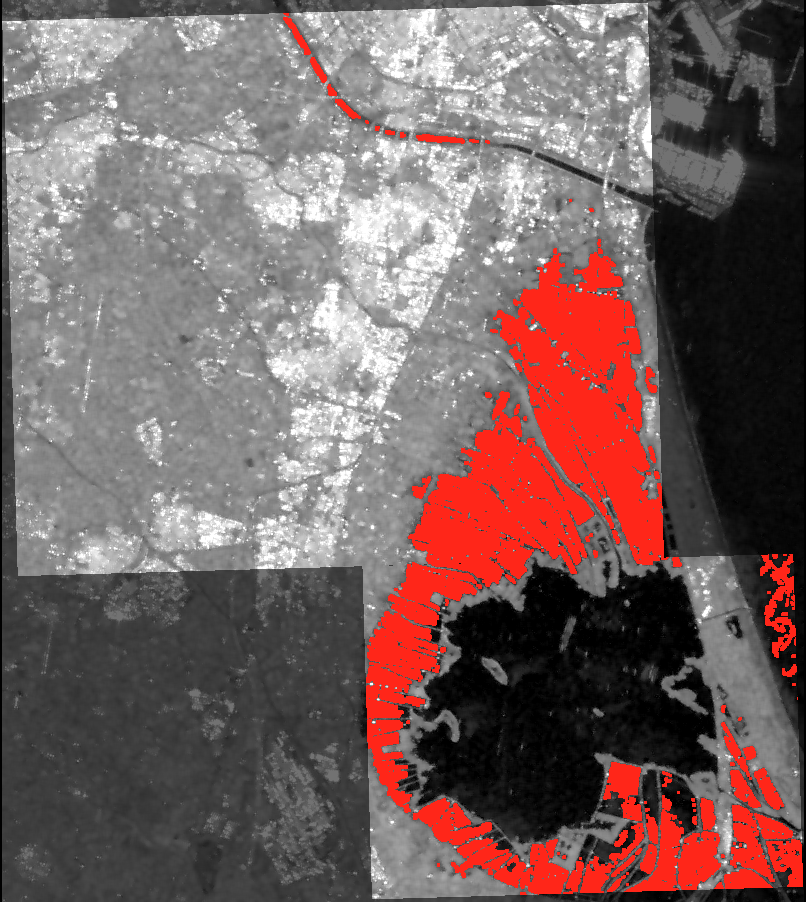

# Sentinel-1 change detection as a service

Pre/post SAR backscatter change on any GeoJSON AOI, delivered as a Dockerized FastAPI service:
flood extent, backscatter increase (debris, new structures) or generic ground disturbance.
Data comes from [Copernicus Data Space](https://dataspace.copernicus.eu) through openEO; outputs are
GeoTIFF masks, a dB difference raster, a PNG preview and area statistics per input polygon.

```
POST /change  {AOI, pre window, post window}  ->  run_id
GET  /runs/{id}                               ->  changed_area_km2, changed_fraction, per-polygon stats
GET  /runs/{id}/mask.tif | diff_db.tif | preview.png
```



*Real run, 15 Nov 2026, on Copernicus Data Space: the October 2024 DANA flood south of Valencia.
Red = newly flooded (backscatter drop below the Otsu threshold of −4.5 dB), grey = post-event VV
backscatter, black = the Albufera lagoon, which is permanent water and correctly left unflagged.
4 pre-event and 2 post-event Sentinel-1 scenes, 20 m grid, 1 min 42 s of processing on the free tier.
Full numbers in [`docs/valencia-2024/result.json`](docs/valencia-2024/result.json).*

| Polygon | Area | Newly flooded | Share |
| --- | ---: | ---: | ---: |
| Horta Sud | 143.5 km² | 17.1 km² | 12.0 % |
| North of the Albufera | 57.5 km² | 12.9 km² | 22.5 % |
| **Total AOI** | **201.0 km²** | **30.1 km²** | **15.0 %** |

Two things a careful reader should know about this map. First, the rice fields around the Albufera are
deliberately flooded every November after the harvest, so part of the red in the southern polygon is
seasonal rather than storm damage; a pre-window from the previous November separates the two (one line
in the request). Second, the towns of Horta Sud were under mud rather than open water by the post
window, and mud-covered urban fabric raises backscatter instead of lowering it, so that damage shows up
in a second pass with `"change_type": "increase"`, not in this flood mask.

## Why this exists

Most remote-sensing change detection stops at a notebook. This repo is the production shape of the
same work: a typed API, a persistent run log (PostGIS), a reproducible process graph, tests that run
without credentials, and a validation tool for checking the output against reference data. It is the
template behind the fixed-scope "Sentinel-1 change-detection pipeline" package I deliver to clients.

## Two-minute demo (no credentials)

Needs Python 3.11–3.13 (tested on all three in CI). With conda: `conda create -n s1cd python=3.13 && conda activate s1cd`.

```bash
pip install -e ".[dev]"
make demo                      # synthetic Sentinel-1-like scenes on a real AOI near Valencia
open runs/demo/preview.png
pytest -q                      # 33 tests, a few seconds
```

Or through the API:

```bash
S1CD_DEFAULT_BACKEND=synthetic uvicorn app.main:app --port 8000
curl -s -X POST "localhost:8000/change?wait=true" -H "content-type: application/json" \
     -d @examples/request_synthetic.json | jq .
```

## Real run on Copernicus Data Space

1. Create a free CDSE account and either register an OIDC client (`S1CD_CDSE_CLIENT_ID/SECRET` in
   `.env`) or leave both empty and complete the device-code login the first time.
2. `docker compose up --build` (API + PostGIS), then:

```bash
curl -s -X POST "localhost:8000/change" -H "content-type: application/json" -d @examples/request_cdse.json
# {"run_id":"7c1e...","status":"queued",...}
curl -s localhost:8000/runs/7c1e...            # poll until "completed"
curl -s localhost:8000/runs/7c1e.../mask.tif -o mask.tif
```

`examples/request_cdse.json` is the October 2024 DANA flood south of Valencia (pre 5–28 Oct, post
30 Oct–12 Nov, descending orbit, VV); the map at the top of this page is its output. The 200 km² AOI at
20 m took 1 min 42 s on the free tier (10,000 openEO credits per month come with every CDSE account).

The synthetic backend reproduces the same scene layout without credentials
([preview](docs/preview_synthetic.png)): a flood, a permanent lake that must not be flagged, and a
bright patch that must not count as a flood. The tests run on it.

## Request

```jsonc
{
  "aoi": { "type": "FeatureCollection", "features": [ /* Polygons, WGS84; stats are reported per feature */ ] },
  "pre":  { "start": "2024-10-05", "end": "2024-10-28" },
  "post": { "start": "2024-10-30", "end": "2024-11-12" },
  "change_type": "flood",          // flood (decrease) | increase | any (|diff|)
  "polarization": "VV",            // VV for open water; VH is sometimes better for vegetation
  "orbit_state": "DESCENDING",     // keep pre and post on the same viewing geometry
  "relative_orbit": null,          // strongest geometry control, if you know the track
  "threshold_db": null,            // null = Otsu on the difference image, with a sanity floor
  "speckle": { "method": "lee", "window": 5 },
  "min_mapping_unit_px": 8,
  "resolution_m": 20,
  "backend": "cdse_openeo"         // cdse_openeo | files | synthetic
}
```

The `files` backend takes two GeoTIFFs you already have (`backend_options.pre_path/post_path`, linear
power or dB) so the same pipeline runs on SNAP or ASF output.

## Method

1. **Composites, not single scenes.** One openEO batch job computes the temporal median of
   backscatter over each window plus the number of valid observations per pixel. Medians over 2–4
   scenes remove more speckle and weather than any spatial filter; the counts are returned so a
   single-scene window is visible in the result (`n_pre_scenes`, `n_post_scenes`, warnings).
2. **Same geometry on both dates.** `orbit_state` or `relative_orbit` filters keep incidence angle and
   look direction constant; mixing ascending and descending passes creates false change on every
   slope and building.
3. **Radiometric terrain correction.** `sigma0-ellipsoid` by default; switch to `gamma0-terrain` in
   relief (`S1CD_CDSE_BACKSCATTER_COEFFICIENT`).
4. **Speckle filter** (Lee, ENL 4.4, or median) on linear power, then dB.
5. **Difference and threshold.** `diff = post − pre` in dB. Otsu on the valid difference pixels; for
   floods the threshold must be below −1.5 dB or the run falls back to −3 dB and says so
   (`threshold_source`), because Otsu on an image with no real flood returns noise.
6. **Masks.** Pixels darker than −20 dB in the pre image are water already and never "newly flooded";
   ESA WorldCover class 80 (permanent water) is excluded when available. Morphological opening and a
   minimum mapping unit remove speckle residue.
7. **Statistics** on an exact UTM grid: area in km², fraction of valid area, per input polygon.

## Validation

```bash
python -m app.cli validate runs/<id>/mask.tif reference_mask.tif --ref-positive 1
```

Reprojects the reference (e.g. a rasterised Copernicus EMS rapid-mapping product) onto the
prediction grid and reports TP/FP/FN/TN, precision, recall, F1, IoU, kappa and the predicted/reference
area ratio. Delivered client work ships with this report on at least two reference events.

## Known limitations

- **Layover and shadow** are not masked (no DEM in this pipeline yet). In mountains, use
  `gamma0-terrain` and expect false change on steep slopes.
- **Wind-roughened water** looks like land in SAR; a windy post-event scene underestimates flood extent.
  Composites over several scenes reduce this but do not remove it.
- **Flooded vegetation and urban flooding** show as a backscatter *increase* (double bounce), not a
  decrease. Run `change_type: "increase"` as a second pass if the AOI has crops or built-up areas.
- **Otsu assumes two populations.** Very small floods relative to the AOI need an explicit
  `threshold_db`.
- Property names used for collection filtering (`sat:orbit_state`, `relativeOrbitNumber`,
  `sar:instrument_mode`) should be checked against `describe_collection("SENTINEL1_GRD")` if a filter
  seems ignored; CDSE metadata names have changed before.

## Layout

```
app/
  main.py            FastAPI routes
  pipeline.py        request -> grid -> backend -> change -> stats -> files
  models.py          Pydantic request/response
  store.py           in-memory or PostGIS run store
  cli.py             run / validate without the server
  validate.py        confusion matrix against a reference mask
  backends/          cdse_openeo (openEO batch job), files (local GeoTIFFs), synthetic (tests/demo)
  processing/        geometry, speckle, change, stats, raster_io
tests/               33 tests; the openEO backend is tested against a fake connection and its calls are bound against the real client signatures
examples/            Valencia AOI, CDSE and synthetic requests
```

## Roadmap

- DEM-based layover/shadow mask (Copernicus DEM via openEO)
- Scheduled monitoring: re-run an AOI after every new acquisition and emit change events
- Sentinel-2 cloud-free composite as an optional optical cross-check
- Per-run cost and timing in the PostGIS log

## License

MIT
